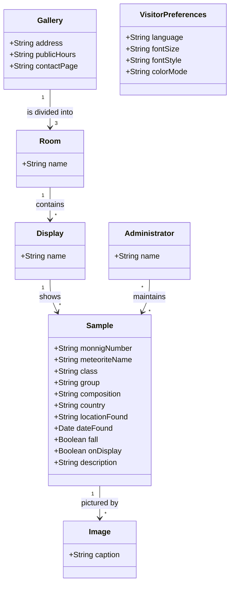

# Software Requirements Specification

**Project:** Monnig Meteorite Gallery Tour App
**Team:** Team 06
**Client:** Heather Stepp and Dr. Rhiannon Mayne
**Version:** 1.1

---

_**How to use this template.** Instructions appear in italic square brackets. Fill in underneath them and leave them in place until the document is stable._

_**What this document is, and what it is not.** The specification describes the external behavior of your system completely enough that a developer can build it and a tester can check it. What it is **not** is a container for everything you have written. Your glossary, vision and scope, use cases, and business rules are separate documents with their own identifiers, and this one **links to them rather than repeating them**._

_That makes the specification mostly a hub. Read that as a feature. One fact, one home: a business rule copied in here is a business rule that will disagree with `business-rules.md` by October, and nobody will notice which copy is right. The sections below that say "link to" are supposed to be short._

_What this document owns outright: the requirements that have no other home. Functional requirements that are not part of any use case, quality attributes, external interfaces, data requirements, operating environment, and constraints._

## Identifiers

_Every requirement in this document carries a name-based slug. Create only the spaces your project actually needs._

| Space | For | Example |
|---|---|---|
| `FR-<AREA>-<slug>` | Functional requirements outside any use case | `FR-DATA-load-failure` |
| `UI-<slug>` | User interface requirements | `UI-visitor-views` |
| `SI-<slug>` | Software and system interfaces | `SI-monnig-catalog` |
| `DI-<slug>` | Data requirements | `DI-catalog-source-of-truth` |
| `OE-<slug>` | Operating environment | `OE-mobile-platforms` |
| `CO-<slug>` | Design and implementation constraints | `CO-store-distribution` |
| `AS-<slug>` / `DE-<slug>` | Assumptions and dependencies | `AS-cellular-in-gallery`, `DE-monnig-catalog` |

_Quality attributes get one space per attribute, so the identifier says which kind of quality it is at the place it is cited: `USE-` usability, `PER-` performance, `SEC-` security, `SAF-` safety, `AVL-` availability, `ROB-` robustness, `SCA-` scalability, `INT-` interoperability, `MNT-` maintainability._

_Requirements cited from elsewhere keep their own identifiers: `UC-*` from [use-cases.md](use-cases.md), `BR-*` from [business-rules.md](business-rules.md), `BO-*`, `SM-*`, `FEAT-*` from [vision-and-scope.md](vision-and-scope.md)._

The `CI-` space (communications interfaces) is not used in release 1.0; see §8.5. Open questions are cited as `OI-<n>` from [OPEN-ISSUES.md](OPEN-ISSUES.md).

## Revision History

| Date | Version | Description | Author |
|---|---|---|---|
| 2026-11-07 | 0.1 | Initial draft from vision and scope, use cases (v2.0), business rules (v0.1), the client interview, and team minutes through 2026-11-06 | Edwin Rodriguez |

---

## 1. Introduction

### 1.1 The purpose of the Monnig Meteorite Gallery Tour App

_[What the system is for: who wants it, why, and who will use it. Even though the vision and scope answers this, restate it in a paragraph here, because people read this document without having read that one.]_

The Monnig Meteorite Gallery is a free museum in the Sid Richardson Building on the TCU campus. Its three rooms display part of a collection of about 3,000 meteorites, and it receives over 10,000 visitors a year, many of them school groups. Today the gallery has almost no digital presence: visitors can learn about the collection only through the gallery's website, the online catalog at monnigcatalog.tcu.edu, or an in-person visit. A 2021–22 app existed, but it was built only for visually impaired visitors and depended on Bluetooth indoor location.

The Monnig Meteorite Gallery Tour App is a mobile app for iOS and Android that gives every visitor, whether in the gallery or at home, an easy way to browse and search the full collection, read about any meteorite, plan a visit, and use the app in their own language and with their own accessibility settings (text size, font, light or dark mode, and text-to-speech). The client is the gallery, represented by Heather Stepp and Dr. Rhiannon Mayne, who gives final sign-off (`BR-final-signoff`). The users are gallery visitors: the general public, visitors with disabilities, and children and families, including school groups.

### 1.2 The purpose of this document

_[What this specification covers and for which release.]_

This document describes the functional and nonfunctional requirements for release 1.0 of the Monnig Meteorite Gallery Tour App, the minimum viable product delivered at the end of the Fall 2026 semester. Release 1.0 covers the MVP features named in [vision-and-scope.md](vision-and-scope.md) §4.3: `FEAT-accessibility-settings`, `FEAT-audio-tts`, `FEAT-exhibit-content`, `FEAT-collection-search`, and `FEAT-translation`. The interactive features (`FEAT-scavenger-hunt`, `FEAT-quizzes`, `FEAT-find-map`, `FEAT-section-screens`, `FEAT-videos-games`) are out of scope for 1.0 and planned for later releases. This document is the reference for the project's requirements, defining the scope, functionality, and constraints for the client, the developers, the testers, and whoever maintains the app after this team graduates.

### 1.3 Document conventions

_[Any typographical conventions, and the identifier formats above, so that someone adding a requirement later knows how to name it.]_

- Every requirement is written in one of the [EARS](https://alistairmavin.com/ears/) shapes and uses **shall**. "Should" and "may" are never used for requirements.
- Every requirement has a name-based identifier from the table in **Identifiers**. To add one, pick the space for its kind and coin a short, lowercase, kebab-case slug from what it is about (for example `PER-detail-load`). Never renumber, rename, or reuse an identifier; a withdrawn requirement keeps its identifier and is marked **Withdrawn**.
- `Code formatting` marks identifiers, field names, and file names.
- **TBD** marks a value that is not yet known. Every TBD cites the `OI-<n>` entry in [OPEN-ISSUES.md](OPEN-ISSUES.md) that will settle it. No threshold in this document was invented; a number appears only where the client, a business rule, or a team decision supplied it, and its source is cited beside it.
- **Proposed** marks a requirement the team has drafted but the client has not confirmed.

### 1.4 References

_[Every document this specification refers to, with a link. At minimum, the four other documents in this folder. Include external standards you must conform to.]_

- [Project glossary](project-glossary.md)
- [Vision and scope](vision-and-scope.md)
- [Use cases](use-cases.md)
- [Business rules](business-rules.md)
- [Open issues](OPEN-ISSUES.md)
- [Client interview, 2026-10-30](client-interview-2026-10-30.md)
- [Team meeting minutes](../meeting%20minutes/) (2026-10-21, 2026-11-02, 2026-11-04, 2026-11-06)
- [Architectural design](../design/architectural-design.md)
- [The Easy Approach to Requirements Syntax (EARS)](https://alistairmavin.com/ears/)
- Monnig Meteorite Gallery website: https://monnigmuseum.tcu.edu/
- Monnig Meteorite Collection catalog: https://monnigcatalog.tcu.edu
- Accessibility standard: none chosen yet (`BR-accessibility-standard`, `OI-3`). When the client names one, add it here.

---

## 2. Overall Description

### 2.1 Product perspective

_[How this system relates to other systems and to the user's environment. Self-contained, or one component of something larger? Link to the product perspective section of your vision and scope and to your architecture's context diagram rather than redrawing them.]_

The app is a new mobile app that replaces the 2021–22 app. It reuses none of that app's Bluetooth location features: indoor location detection and display-code (QR) scanning were removed from scope on 2026-11-02, and gallery navigation is by room selection instead (minutes, 2026-11-04). The app reads meteorite data from the gallery's existing collection catalog (`SI-monnig-catalog`), opens the gallery's website for visit planning, and is distributed through the Apple App Store and Google Play (`BO-store-release`). It does not replace the gallery's website or catalog, and it does not change either one.

Whether the app reads the catalog directly or keeps its own copy of the data, possibly behind an admin-editable database, is open (`OI-4`). The answer decides whether there is a back end at all.

See the context diagram in [vision-and-scope.md](vision-and-scope.md) §4.1 (moving to [architectural-design.md](../design/architectural-design.md) §3).

### 2.2 User classes and characteristics

_[The kinds of user, and what distinguishes them: frequency of use, technical skill, privilege level, whether they are inside or outside the client's organization. Link to the stakeholder profiles in your vision and scope; what belongs here is what affects the software's behavior, especially permissions.]_

Stakeholder profiles are in [vision-and-scope.md](vision-and-scope.md) §3.1. The user classes that affect the software's behavior are:

| User class | Who | Frequency | Technical skill | Privilege |
|---|---|---|---|---|
| **Visitor** | Members of the public, in the gallery or remote (see *Remote Visitor* in the glossary). Outside the client's organization. Includes visitors with disabilities who already use their own assistive tools. | Mostly one visit of about 30–60 minutes; some return. | From none to high. | Read-only; no account (`FR-CONTENT-visitor-read-only`). |
| **Child visitor** | Pre-K through 12th grade, mostly in school groups of up to about 30 (`BR-group-size-split`). The client says reading-based activities work from 3rd grade up (interview §5). | One visit. | Pre-readers to teens. | Same as Visitor. Their age drives `USE-*` requirements and the privacy questions in `OI-16`. |
| **Gallery administrator** | Gallery staff the client designates (`BR-only-admin-can-edit-database`). Inside the client's organization. | Rarely; exhibits are mostly permanent (`BR-permanent-exhibit`). | Not developers. | The only class that may add or change content. Whether release 1.0 gives them any editing tool is `OI-11`. |

### 2.3 Operating environment

_[The environment the software runs in: hardware, operating systems and versions, browsers, where users and servers are located, and any other software it has to coexist with.]_

- `OE-mobile-platforms`: The app shall run on iOS and Android phones. The oldest supported version of each operating system is TBD (`OI-14`).
- `OE-gallery-tablets`: Where the gallery provides its own tablets for visitors, the app shall run on them. Whether the gallery will provide tablets, and which kind, is open (`OI-7`).
- `OE-gallery-network`: Inside the gallery, the app shall work over the visitor's cellular data connection, because the gallery has no guest Wi-Fi network (interview §7). Wi-Fi and cell service in the gallery rooms are reported as good.
- `OE-remote-use`: The app shall work for remote visitors anywhere they have an internet connection; nothing in the app shall require being in the gallery.
- `OE-catalog-host`: The collection catalog at monnigcatalog.tcu.edu is hosted outside this project. Who operates it is open (`OI-4`).

### 2.4 Design and implementation constraints

_[Anything that limits the developers' options: corporate or regulatory policy, hardware limits, required languages or databases, coding standards, interfaces to other applications.]_

- `CO-store-distribution`: The app shall be distributed as an installable app through both the Apple App Store and Google Play (`BO-store-release`). It shall therefore meet each store's review guidelines, including their rules for apps used by children (`OI-16`).
- `CO-monnig-branding`: The app shall use the Monnig logo and the gallery's purple-and-white color scheme, and shall not use TCU branding (`BR-monnig-branding`, `BR-no-tcu-affiliation`). How far "no TCU affiliation" extends (app name, publisher account, store listing) is open (`OI-17`).
- `CO-no-in-gallery-photography`: Release 1.0 shall include no feature that asks visitors to take photographs inside the gallery (`BR-no-gallery-photography`). Before any camera feature is added in a later release (QR scanning, a photo scavenger hunt), the rule's scope must be confirmed (`OI-15`).
- `CO-client-funded-services`: The app shall use no paid service (developer accounts, hosting, translation, text-to-speech) unless the gallery has agreed to pay for it (`BR-monnig-funds-costs`). Who approves a purchase is open (`OI-5`).
- `CO-maintainer-stack`: The technology stack shall be one that the post-course maintainer can build, publish, and update. Who that is, and what they know, is open (`OI-5`). The team has begun setup with Flutter (minutes, 2026-11-06). That is a team decision, not an external constraint, and it is recorded with its rejected alternatives in [architectural-design.md](../design/architectural-design.md) §9, not here.

### 2.5 Assumptions and dependencies

_[An assumption is a factor you believe true without proof, which would change these requirements if it turned out false. A dependency is something outside your control that the project relies on: an external API, a third-party library, a change someone else has to make.]_

Assumptions and dependencies already recorded in [vision-and-scope.md](vision-and-scope.md) §2.7 are cited, not restated: `AS-prior-assets-from-asa`, `AS-collection-db-access`.

- `AS-visitor-own-device`: Visitors use their own phones (vision and scope §3.1, "Own Device"). If the gallery provides tablets instead or as well, `FR-PREF-reset-for-new-visitor` becomes required and `OE-gallery-tablets` needs a device list (`OI-7`).
- `AS-cellular-in-gallery`: Visitors' phones have usable cellular data inside the gallery (interview §7). If false, the app must work without a network (`OI-12`).
- `AS-catalog-data-sufficient`: The catalog holds, or can be made to hold, the fields the use cases display and filter on (name, type, composition, location found, date found, on display). The team has noted that the database it was sent "has very little information on each meteorite" (minutes, 2026-11-06). If false, the content has to come from somewhere else (`OI-4`).
- `DE-monnig-catalog`: Showing the collection depends on read access to the catalog at monnigcatalog.tcu.edu, through an export or an API, from whoever owns it (`OI-4`).
- `DE-app-store-accounts`: Release depends on an Apple Developer account and a Google Play developer account, paid for by the gallery (`BR-monnig-funds-costs`) and owned by whoever publishes the app (`OI-5`, `OI-17`).
- `DE-device-tts`: Text-to-speech depends on a speech engine that supports every language in `FR-LANG-supported-languages`, either the one built into the device or a paid service (`CO-client-funded-services`).
- `DE-gallery-content-review`: Descriptions and translations of scientific terms depend on review by the gallery (`RI-translation-accuracy`). Who reviews, and whether review is required before publishing, is open (`OI-9`).

---

## 3. Project Glossary

_[Link only. The glossary is [project-glossary.md](project-glossary.md).]_

See [project-glossary.md](project-glossary.md). "Database" and "Catalog" are synonyms there; this document says "catalog" for the gallery's existing system at monnigcatalog.tcu.edu.

## 4. Vision and Scope

_[Link only. Business requirements, objectives, metrics, and scope live in [vision-and-scope.md](vision-and-scope.md).]_

See [vision-and-scope.md](vision-and-scope.md).

---

## 5. Functional Requirements

### 5.1 Use cases

_[Link to [use-cases.md](use-cases.md). Most of your system's behavior is specified there, as use cases, and it does not get restated here.]_

See [use-cases.md](use-cases.md). As of version 2.0 it specifies `UC-PREF-identify-language-preference`, `UC-PREF-customize-visual-preferences`, `UC-DAT-display-database`, `UC-DAT-filter-database`, and `UC-DAT-display-meteorite`. Use cases still to be written, per the team minutes of 2026-11-04 and 2026-11-06: a Settings use case, one general reset use case, text-to-speech (`UC-TTS-listen-to-content` and `UC-TTS-control-playback` are being drafted), and the Tour area (room selection). The requirements below that depend on them say so.

### 5.2 Non-use-case functional requirements

_[Behavior that is real, testable, and belongs to no single use case: autosave, validation applied everywhere, notification, authorization, audit logging. If you find yourself writing the same step into six use cases, it belongs here instead._

_Group them under sub-headings by concern, and write each one using an [EARS](https://alistairmavin.com/ears/) shape so that it cannot be read two ways:_

- _**Ubiquitous:** The `<system>` shall `<response>`._
- _**Event driven:** When `<trigger>`, the `<system>` shall `<response>`._
- _**State driven:** While `<in a state>`, the `<system>` shall `<response>`._
- _**Optional:** Where `<feature is included>`, the `<system>` shall `<response>`._
- _**Unwanted behavior:** If `<precondition>`, then the `<system>` shall `<response>`._

_Example: `FR-SAVE-autosave-active`: While a student is editing a weekly activity report during an active week, the system shall persist the draft every 30 seconds._

_**Every requirement here needs an oracle.** If you cannot say how a tester would tell whether it holds, it is not a requirement yet.]_

#### Meteorite data (lifted from the three `UC-DAT-*` use cases)

- `FR-DATA-load-failure`: If the app cannot retrieve meteorite data, or retrieves only part of what it requested, then the app shall show a message saying the information could not be loaded, offer a way to try again, and keep the rest of the app usable.
  _Applies to:_ `UC-DAT-display-database` 3a and 4a, `UC-DAT-filter-database` 8a and 9a, `UC-DAT-display-meteorite` 3a and 4a.
  _Oracle:_ with the data source unreachable (airplane mode, or a test double that fails or returns a partial result), open each of the three screens. Each shows the message and a retry control, the app does not crash, and Settings still opens.
- `FR-DATA-missing-field`: If a meteorite record has no value for a field the app displays, then the app shall show "[NOT INDICATED]" in place of that value and show every field that does have a value.
  _Lifted from_ `UC-DAT-display-meteorite` 4b, because a card or filter can hit the same gap. The use case's "bold red text" is a design detail and, if red is the only signal, conflicts with common accessibility guidance on not using color alone; leave the styling to the design document.
  _Oracle:_ load a test record with each displayed field empty in turn.
- `FR-DATA-no-results`: If no meteorite matches the active filters, then the app shall show "No meteorites match current filters." in place of the list (`UC-DAT-filter-database` 9b).

#### Content ownership

- `FR-CONTENT-visitor-read-only`: The app shall give visitors no way to add, change, or delete meteorite or gallery content (`BR-only-admin-can-edit-database`).
  _Oracle:_ inspect every visitor screen; no editing control exists, and the app holds no credential that can write to the data source.
- `FR-CONTENT-no-visitor-account`: The app shall let a visitor use every release 1.0 feature without signing in or creating an account. **Proposed** (`OI-16`).

#### Preferences (cross-cutting; the `UC-PREF-*` use cases set them, every screen honors them)

- `FR-PREF-apply-everywhere`: When a visitor confirms a change to language, font size, font style, or light/dark mode, the app shall apply it to every screen, including screens opened afterward, without restarting.
  _Oracle:_ change each preference, then visit every screen in `UI-visitor-views`.
- `FR-PREF-settings-reachable`: The app shall make Settings reachable in one tap from every main screen (decision, minutes 2026-11-06: preferences live in one Settings tab, not a floating control).
- `FR-PREF-persist`: When the app is closed and reopened on the same device, the app shall restore the visitor's last confirmed preferences and shall not show the first-launch language screen again. **Conflict to resolve:** `UC-PREF-identify-language-preference` POST-1 says the preference is stored "temporarily" for the session; the 2026-11-02 decision says preferences are set on first launch and kept. Settle in `OI-8`, then fix whichever document is wrong.
- `FR-PREF-reset-for-new-visitor`: Where the app runs on a gallery-owned device, when a "new visitor" reset is chosen, the app shall clear all preferences and return to the first-launch language screen (decision, minutes 2026-11-02 and 2026-11-04; the general reset use case is not yet written). Required only if `OI-7` confirms gallery devices.

#### Language

- `FR-LANG-supported-languages`: The app shall offer English and Spanish (decision, minutes 2026-11-06). French and Vietnamese, also listed in `BO-language-options`, are deferred to a later release (`OI-9`).
- `FR-LANG-interface-text`: The app shall show all interface text (labels, buttons, messages, including those in `FR-DATA-*`) in the selected language.
- `FR-LANG-content-fallback`: If a piece of meteorite content has no translation in the selected language, then the app shall show the English text and mark it as not translated. **Proposed** (`OI-9`).
  _Oracle:_ select Spanish; every interface string on every screen is Spanish; a record with English-only text shows the English with the marker.

#### Text-to-speech

- `FR-TTS-read-description`: Where text-to-speech is included, when a visitor asks for a meteorite's, gallery section's, or exhibit's description to be read aloud, the app shall read its name and description in the selected language, shall not read text that has no translation in the selected language, and shall let the visitor pause it at any time (`UC-TTS-control-playback`). Specified by `UC-TTS-listen-to-content`. What else must be readable depends on the accessibility standard chosen (`OI-3`).
- `FR-TTS-stop-on-leave`: When the visitor leaves the screen that is reading aloud, the app shall stop reading.

#### Visit planning

- `FR-PLAN-contact-link`: The app shall provide a "Plan a visit" link that opens the gallery's contact page on monnigmuseum.tcu.edu (decision, minutes 2026-11-06; a booking flow inside the app is out of scope for 1.0).
- `FR-PLAN-visitor-info`: The app shall show the gallery's address and public opening hours. **Proposed**; where the hours are kept so they stay current is part of `OI-11`.

#### Visitor survey (pending)

- `FR-SURVEY-optional`: Where the visitor survey is included, the app shall let a visitor answer it or skip it without losing access to any other feature. Whether the survey is in release 1.0, and which fields it asks, is open (`BR-visitor-survey-data`, `OI-10`).

---

## 6. Business Rules

_[Link only, to [business-rules.md](business-rules.md). Business rules are a rich source of requirements because they dictate properties the system must have in order to conform to them, but the rules themselves are properties of the client's business, not of your software, and they have their own document.]_

See [business-rules.md](business-rules.md). Rules enforced or constrained by this document: `BR-only-admin-can-edit-database` (`FR-CONTENT-visitor-read-only`), `BR-monnig-branding` and `BR-no-tcu-affiliation` (`CO-monnig-branding`), `BR-no-gallery-photography` (`CO-no-in-gallery-photography`), `BR-monnig-funds-costs` (`CO-client-funded-services`), `BR-group-size-split` (`SCA-group-concurrency`), `BR-accessibility-standard` (`USE-accessibility-standard`), `BR-visitor-survey-data` (`FR-SURVEY-optional`, §7.3), `BR-permanent-exhibit` (`MNT-content-update`), `BR-final-signoff` (§11).

---

## 7. Data Requirements

### 7.1 Business domain model

_[The entities in the problem domain and how they relate, as a mermaid class diagram. Model the **business**, not your database schema: this is what the client would recognize, before any decision about tables or persistence.]_

Terms follow the [glossary](project-glossary.md): a **Sample** is an individual meteorite in the collection, on display or not; a **Display** is a case holding one or more samples; a **Room** is one of the gallery's three rooms.

Not every sample is in a display: most of the collection is not on view, and `UC-DAT-filter-database` filters on that. `VisitorPreferences` belongs to a device, not to a person; there are no visitor accounts. Whether the business distinguishes a **meteorite** (the fall or find) from its **samples** (pieces of it) was skipped in the interview (§2) and should be asked, because it changes this model (`OI-4`).

### 7.2 Data dictionary

_[Each entity's fields, with data type, allowed values, defaults, and validation rules. Where a use case already specifies a field's validation in its Associated Information, cite the use case instead of repeating it.]_

**Sample.** The team has not yet seen the catalog's real fields (`AS-catalog-data-sufficient`, `OI-4`), so types and allowed values below are what the use cases need, not what the catalog holds. Confirm each row against the catalog before design.

| Field | Type | Required | Allowed values / validation | Used by | Glossary |
|---|---|---|---|---|---|
| `monnigNumber` | text | Yes | The gallery's catalog number; unique | identity | Monnig # |
| `meteoriteName` | text | Yes | — | `UC-DAT-display-database` (card), `UC-DAT-display-meteorite` | Meteorite Name |
| `class` | enum | No | Iron, Stone, Stony-iron | type filter | Class |
| `group` | enum | No | Chondrite, Primitive achondrite, Achondrite (per glossary; confirm list) | type filter | Group |
| `composition` | text | No | Allowed values TBD (`OI-4`) | composition filter | — |
| `country` | text | No | — | location filter | Country |
| `locationFound` | text | No | Text-matched by the location filter (`UC-DAT-filter-database` step 5) | location filter, detail | — |
| `dateFound` | date or year | No | Not in the future; precision TBD (`OI-4`) | time-range filter (step 6), detail | — |
| `fall` | boolean | No | Whether the fall was observed | detail | Fall |
| `onDisplay` | boolean | Yes | Default `false` | on-display filter | — |
| `description` | long text, per language | No | — | detail, `FR-TTS-read-description` | — |
| `images` | list of Image | No | Card shows the first image if any (`UC-DAT-display-database` step 6) | card, detail | — |

Any field with no value is displayed per `FR-DATA-missing-field`.

**VisitorPreferences** (stored on the device only):

| Field | Type | Allowed values | Default | Source |
|---|---|---|---|---|
| `language` | enum | English, Spanish | English | `UC-PREF-identify-language-preference` 1a; `FR-LANG-supported-languages` |
| `fontSize` | enum | One of four sizes | TBD (`OI-8`) | `UC-PREF-customize-visual-preferences` step 4 |
| `fontStyle` | enum | One of four styles | TBD (`OI-8`) | `UC-PREF-customize-visual-preferences` step 3 |
| `colorMode` | enum | Light, Dark | TBD; dark was suggested, not decided (minutes, 2026-11-06) | `UC-PREF-customize-visual-preferences` step 6 |

**Image**: a picture and an optional caption. Who owns the photographs, and what credit they need, is open (`OI-15`).

### 7.3 Reports

_[Any report the system generates: who reads it, what it contains, how often, and in what format. Reports are where clients discover late that a field they need was never captured, so specify them early.]_

Release 1.0 generates no reports, with one pending exception. The gallery's grants call for visitor survey responses and age ranges: children's age or grade range and adult age range (`BR-visitor-survey-data`). If the app collects these, the gallery will need a report of them for its funders. Because answers that are not captured from launch can never be reported, the fields, how often they are reported, and in what format must be settled before the survey is built (`OI-10`).

### 7.4 Data acquisition, integrity, retention, and disposal

_[Where the data comes from, how it is kept correct, how long it is kept, and how it is destroyed. If your system holds anything about students or other identifiable people, this section is not optional, and its content is usually a business rule you should cite rather than invent.]_

- **Acquisition.** Meteorite data comes from the gallery's catalog (`DE-monnig-catalog`). Descriptions and pictures that are not in the catalog may come from the 2021–22 app (`AS-prior-assets-from-asa`) or be written by the gallery (minutes, 2026-11-04). Translations come from the team, a translation service, or the gallery, and are reviewed per `DE-gallery-content-review`.
- `DI-catalog-source-of-truth`: The app shall treat the gallery's catalog (or the database the client designates in its place, `OI-4`) as the only source of meteorite data, and shall never write to it (`FR-CONTENT-visitor-read-only`).
- `DI-preferences-on-device`: The app shall store visitor preferences only on the visitor's device, and shall delete them when the app is uninstalled or reset (`FR-PREF-reset-for-new-visitor`).
- `DI-no-personal-data`: Release 1.0 shall collect no personal information about visitors: no name, email, account, precise location, or photo. **Proposed**; if the survey is added, what it collects, how long it is kept, and how it is disposed of must come from the grant's terms (`BR-visitor-survey-data`, `OI-10`), and collecting anything from children under 13 brings in federal children's-privacy rules and both stores' rules for children's apps (`OI-16`).
- **Retention and disposal of meteorite data** are the gallery's, not the app's. If the app keeps a cached copy (`OI-4`), the copy shall be refreshed or discarded when the catalog changes (`MNT-content-update`).

---

## 8. External Interface Requirements

### 8.1 User interfaces

_[The user-facing surfaces, at requirement level: which views exist, standards they must conform to, accessibility requirements. Link to wireframes or prototypes rather than describing pixel layouts.]_

- `UI-visitor-views`: Release 1.0 shall provide these views: first-launch language selection (`UC-PREF-identify-language-preference`); Home; Meteorite Database list (`UC-DAT-display-database`) with its filter panel (`UC-DAT-filter-database`); meteorite detail (`UC-DAT-display-meteorite`); Settings, holding language, font size, font style, light/dark mode, and, on gallery devices, reset (`UC-PREF-customize-visual-preferences`, `FR-PREF-settings-reachable`); and Plan a Visit (`FR-PLAN-contact-link`).
- `UI-room-selection`: The app shall provide a gallery map divided into its three rooms, where tapping a room lists what is in it (decision, minutes 2026-11-04). The Tour use cases that specify it are not yet written; until they are, this requirement is **Proposed**, and whether it ships in 1.0 depends on `OI-1`.
- `UI-language-picker`: The language choice shall show each language's name, with or without a flag (`UC-PREF-identify-language-preference` step 1). Flags stand for countries rather than languages, so the name is the label that counts.
- `UI-branding`: Every view shall follow `CO-monnig-branding`.
- `UI-accessibility`: Every view shall meet `USE-accessibility-standard`.

Wireframes: not yet made; a wireframe session is planned (minutes, 2026-11-06). Link here when they exist.

### 8.2 Hardware interfaces

_[Any hardware the system talks to, or "none".]_

None beyond the visitor's own device. Text-to-speech plays through the device's speaker or headphones by way of the operating system. Release 1.0 does not use the camera (QR scanning was removed, minutes 2026-11-02; see `CO-no-in-gallery-photography`), Bluetooth, or location services.

### 8.3 Software interfaces

_[Other software systems yours connects to: what crosses the boundary, in which direction, in what format, and what happens when the other side is unavailable.]_

- `SI-monnig-catalog`: The app shall read meteorite records from the gallery's catalog at monnigcatalog.tcu.edu, or from the database the client designates in its place. Data flows one way, from the catalog to the app. The access method (export, API, or a copy) and format are open (`OI-4`). When the catalog is unavailable, the app behaves per `FR-DATA-load-failure`.
- `SI-device-speech`: The app shall use a text-to-speech engine for `FR-TTS-read-description`, either the device's built-in engine or a service the gallery pays for (`DE-device-tts`). If no voice is available for the selected language, the app shall say so rather than read in the wrong language.
- `SI-gallery-website`: The app shall open the gallery's contact page in the device's browser (`FR-PLAN-contact-link`). Nothing else crosses this boundary.

### 8.4 API document

_[Link to your API documentation. It is generated from the code, so link it rather than transcribing endpoints that will be stale within a week.]_

None yet. If `OI-4` is settled with a back end of the team's own, link its generated API documentation here.

### 8.5 Communications interfaces

_[Email, notifications, messaging, and the protocols involved.]_

Not applicable for release 1.0: the app sends no email, push notifications, or text messages. All network traffic uses HTTPS (`SEC-https-only`).

---

## 9. Quality Attributes

_[How well the system does what it does. **This is the section that decides whether your client is happy with software that meets every functional requirement**, so do not treat it as a formality.]_

_The rule for every entry: an adjective is not a requirement. "Fast", "easy", "secure", and "user-friendly" are the starting point of a conversation, not the end of one. Each entry needs a number and a way to measure it._

_Write one subsection per attribute your project actually has, and say "not applicable" with a reason for the ones it does not. An explicit "not applicable" is information; silence is not._

### 9.1 Usability

- `USE-accessibility-standard`: All views shall conform to the accessibility standard the gallery chooses (`BR-accessibility-standard`, `OI-3`). Until it chooses, no part of this project shall claim compliance with a named standard. The team will propose WCAG 2.1 level AA to the client as a candidate; the decision is the client's.
  _Oracle, once chosen:_ an automated accessibility scan plus a manual pass with VoiceOver (iOS) and TalkBack (Android) over every view in `UI-visitor-views`.
- `USE-screen-reader`: Every control and image in the app shall have a label that the device's screen reader (VoiceOver, TalkBack) reads. _Oracle:_ the manual pass above finds no unlabeled element. Visitors with disabilities already use their own assistive tools (vision and scope §3.1), so the app must work with them, not replace them.
- `USE-text-scaling`: At every font size `UC-PREF-customize-visual-preferences` offers, no text in any view shall be cut off or overlap. _Oracle:_ visit every view at each of the four sizes in both languages.
- `USE-young-visitors`: Interface text shall be understandable by the youngest reading visitors the client names. **TBD**: the client says reading-based activities work from 3rd grade (interview §5), but has not said whether the core app must serve that age (`OI-1`).
- `USE-tested-with-real-users`: Before release, the app shall be tested with gallery staff and at least one school group, as the client offered (interview §8: staff, grad students, a group going through the gallery, Starpoint School). Visually impaired visitors have not been offered for testing (`RI-no-visually-impaired-users` in the interview record), which is a known gap.

### 9.2 Performance

- `PER-database-list`: The Meteorite Database list shall show its first screen of results within **TBD** seconds of opening it, at the 95th percentile, on a mid-range phone over cellular data inside the gallery.
- `PER-detail-load`: A meteorite's detail view shall be complete within **TBD** seconds at the 95th percentile, under the same conditions.
- `PER-filter-response`: Applying filters shall show the filtered list within **TBD** seconds over the full collection (`SCA-full-collection`).

All three thresholds are TBD (`OI-13`). Set them from a measurement taken in the gallery once a first build exists, and have the client agree to them; the answer to `OI-4` (live queries or a local copy) will change them by a lot.

### 9.3 Security

- `SEC-https-only`: The app shall make every network request over HTTPS.
- `SEC-no-write-credentials`: The app shall contain no credential, key, or password that can change the catalog or any content source. _Oracle:_ inspect the built app package and the repository.
- `SEC-admin-authenticated`: Where a content-editing tool for administrators is included (`OI-11`), it shall authenticate every request to change content and shall refuse any request that is not from an administrator (`BR-only-admin-can-edit-database`).

### 9.4 Safety

`SAF-not-applicable`: The app displays educational information and controls nothing physical, so its failure cannot cause physical harm. Handling meteorites during the hands-on mini lesson is a gallery activity, not an app feature.

### 9.5 Availability

- `AVL-gallery-hours`: The app's meteorite data shall be available during the gallery's public hours (currently Monday to Saturday, 1:00 to 4:00 p.m., per monnigmuseum.tcu.edu) and during booked group tours. The required level is **TBD** (`OI-12`). If the data is read live from the catalog (`OI-4`), the app's availability can be no better than the catalog's, which this team does not control (`DE-monnig-catalog`).

### 9.6 Robustness

- `ROB-no-crash-on-bad-data`: If a record from the data source is malformed or missing fields, then the app shall show it per `FR-DATA-missing-field` and shall not crash. _Oracle:_ feed the app a test set with empty, oversized, and wrongly typed values.
- `ROB-offline`: If the device has no network connection, then the app shall still open, show Settings, and show any data it has already loaded. Whether the full collection must be readable offline is open (`RI-connectivity`, `OI-12`).

### 9.7 Scalability, interoperability, maintainability

- `SCA-full-collection`: The app shall list, filter, and display the entire collection, about 3,000 meteorites (vision and scope §2.1), and not only those on display (`BO-display-collection`). _Oracle:_ load the full catalog, or a synthetic set of 3,000 records if it is not yet available, and repeat the `PER-*` measurements.
- `SCA-group-concurrency`: The app shall meet the `PER-*` thresholds while 30 visitors use it at the same time in the gallery, the largest group the gallery takes (`BR-group-size-split`). _Oracle:_ a load test of 30 simultaneous clients against whatever data source `OI-4` chooses.
- `INT-two-platforms`: Every release 1.0 feature shall behave the same on iOS and Android. _Oracle:_ run the acceptance tests on one device of each.
- `MNT-content-update`: When an administrator adds or changes a meteorite, the change shall reach visitors without a new app-store release. **Proposed** (Cody's leaning, minutes 2026-11-06, not decided); it follows from `BR-only-admin-can-edit-database` and the Texas map being replaced with each new find (`BR-permanent-exhibit`). Depends on `OI-4` and `OI-11`.
- `MNT-setup-docs`: The repository shall contain instructions that let a developer new to the project build and run the app on the Android emulator and the iOS simulator, and publish a release to both stores. _Oracle:_ before hand-off, someone outside the team follows them without help; time allowed is **TBD** (`OI-5`).
- `MNT-handoff`: Before the course ends, the team shall hand to the person named in `OI-5` the repository, the store accounts' ownership, and any service accounts, all in the gallery's name.

---

## 10. Internationalization and Localization

_[Languages, character sets, time zones, date and currency formats. If the answer is a single locale, say so and say why, because that is a real constraint on who can use the system.]_

Release 1.0 supports **English and Spanish** (`FR-LANG-supported-languages`), chosen for the gallery's Texas audience (minutes, 2026-11-06). `BO-language-options` also names French and Vietnamese; they are deferred, not dropped, so:

- All interface text shall be kept in per-language resource files, never written into the code, so a language can be added without changing any view.
- Text shall be stored and displayed as Unicode, so that Vietnamese diacritics and any later language display correctly.
- Meteorite names are proper names and are not translated. Scientific terms in descriptions are translated only with the review in `DE-gallery-content-review`, because machine translation garbles them (`RI-translation-accuracy`).
- Dates of find are shown in the format of the selected language. Gallery hours are in U.S. Central time.
- No currency is used.

---

## 11. Other Requirements

_[Anything real that fits nowhere above: legal, licensing, installation, training, documentation. Delete this section if it is empty rather than leaving it as a placeholder.]_

- **Approval.** Dr. Rhiannon Mayne gives final sign-off on the release, with input from Heather Stepp (`BR-final-signoff`).
- **App store listings.** Each store listing shall present the app as a Monnig Meteorite Gallery product (`BR-no-tcu-affiliation`, `OI-17`) and shall carry the privacy declarations each store requires, which follow from `DI-no-personal-data`.
- **Licensing.** Every font offered in the font style setting, every image, and every audio file shall be licensed for distribution in a published app (`OI-15`).
- **Training.** None needed for visitors. If an administrator tool is built (`OI-11`), the team shall walk gallery staff through it before hand-off.

---

## Working this document with your agent

_[Delegate: converting prose requirements into EARS shapes; checking that every `UC-*`, `BR-*`, and `FEAT-*` cited here exists in the document that owns it; finding functional requirements that appear in several use cases and should be lifted into section 5.2; drafting an oracle for a quality attribute you have stated only as an adjective._

_Keep human: the numbers. Every threshold in section 9 is a commitment somebody has to live with, and an agent will supply a plausible one (99.9% uptime, 200ms response) that nobody asked for and no one can meet. A number in this document either came from your client, from a measurement, or from a decision your team made deliberately and can defend._

_**The specific failure to watch for: invented precision.** A generated specification reads as authoritative at exactly the points where it is guessing. Check every number, every browser version, every retention period against something real, and put the ones you cannot verify in [OPEN-ISSUES.md](OPEN-ISSUES.md) instead of leaving a confident guess in the document your team will build from.]_
