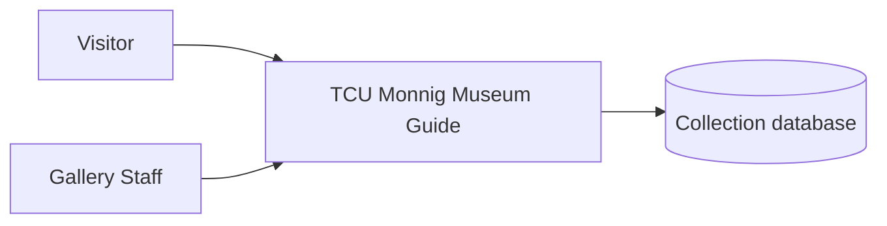

# Vision and Scope

**Project:** Monnig Meteorite Gallery Tour App<br>
**Team:** 06<br>
**Client:** Monnig Meteorite Gallery<br>
**Version:** 0.1<br>

---

_**How to use this template.** Every section below opens with an instruction in italic square brackets: what the section is for, how to produce it, a worked example, and a checklist. Fill in the section underneath the instruction. **Leave the instructions in the file until the document is stable.** They are context for you, for the teammate who writes a later section, and for your AI teammate, which reads this file every time it works on your project._

_**This document has two readers.** Your client has to recognize their own business in it, so avoid jargon they would not use. Your AI teammate has to build from it, so avoid a claim it cannot check. When the two pull against each other, write for the client and put the precision in the use cases._

_**Work it with your agent, not instead of it.** Give the agent this template, your one-page project brief, and your meeting notes, then put it in a role: "You are an experienced business analyst. Using the instructions in this template, draft section X, and list every question you cannot answer from what I gave you." The questions it cannot answer are the point. They go in [OPEN-ISSUES.md](OPEN-ISSUES.md) and they become the agenda for your next client meeting. What the agent cannot do is decide which of its questions deserve your client's limited time, or tell enthusiasm apart from commitment. That judgment is yours._

## Identifiers in this document

_Identifiers here are **name-based slugs**, never numbers._

| Space | Shape | Example |
|---|---|---|
| Business objective | `BO-<slug>` | `BO-grading-time` |
| Success metric | `SM-<slug>` | `SM-submission-rate` |
| Risk | `RI-<slug>` | `RI-cloud-cost` |
| Assumption or dependency | `AS-<slug>` | `AS-client-maintains-stack` |
| Feature | `FEAT-<slug>` | `FEAT-performance-tracking` |

_Coin each slug from the concept itself: short, kebab-case, unique within its space. **Never renumber, rename, or repoint an identifier.** A new item gets a new slug; a retired item keeps its slug and is marked withdrawn. Cite items by identifier, never by position in a list ("the third objective")._

_Why this matters more with an agent than it used to: ask an agent to insert a new objective into a list numbered `BO-1` through `BO-6` and it has two options. Renumber everything, silently breaking every citation in your use cases and your specification, or append out of order. No test you can write detects either one. A slug has neither failure mode, and it tells a reader what the item is at the place it is cited._

## Revision History

| Date | Version | Description | Author |
|---|---|---|---|
| 10/1/2021 | Alpha 1.0 | Starting Documents | Asa Tuten |
| 11/17/2021 | Alpha 2.0 | Updating Documents | Aparajita Biswas |
| 10/22/2026 | 1.0 | Updating Documents | Cody Pinkston |
---

## 1. Introduction

_[This document defines the goals, purpose, and boundaries of the project. It gives every stakeholder a shared understanding of what the software is for and the context it operates in: the business problem being solved, how the software fits into the client's world, and where the line falls between what is in scope and what is not.]_

This document defines the vision, scope, and business context for the TCU Monnig Museum Guide, a mobile app for all gallery visitors with accessibility built in. Note that it replaces the earlier version, which was built around visually impaired users and indoor location, and that detailed behavior lives in the use cases and supplementary specification.

### 1.1 Background

_[Summarize the rationale and context for the new product, or for the changes to an existing one. Describe the situation that led to the decision to build it.]_

_**Step 1: Describe the business.** Introduce the organization. Cover what it does (industry, products, services), its size (employees, locations), and the goals that relate to the problem you are solving._

_**Checklist:** Would a reader who has never heard of this organization understand what it does and why this project exists?_


The Monnig Meteorite Gallery is a museum on TCU campus in the Sid Richardson Building. The gallery opened on February 1, 2003, Since then the Gallery has not had a large digital footprint and is not accessible in the digital space. The gallery has over 10,000 visitors of all ages per year. The Gallery itself is contained in 3 large rooms and is mainly supported by the staff at TCU(Dr. Rhiannon Mayne and Dr. Heather Stepp). The goal of the project is to make the gallery more digitally accessible to everyone. This included having all of the information on the gallery in the app in a easy to access way, also featuring content that is not included in the gallery, and still having accessible/ADA features for people who need it. This is building on top of an app that was built in 2021.  

### 1.2 Current Process Flows (As-Is Process Flows)

_[Most projects require everyone involved to have a firm grasp of the business process being created, replicated, or improved. Without that understanding there is little chance users adopt the new solution. Process flows are the most effective model for building it.]_

_**Step 1: Diagram the current process.** Draw the process people execute **today**, before your software exists, as a mermaid flowchart with **one subgraph per actor** (roles, departments, existing systems). Show the sequence of activities, the decision points, and the handoffs between actors._

_Diagrams in this project are authored as mermaid inside the Markdown file, never exported from a drawing tool as an image. A picture of a diagram is invisible to your AI teammate and unreadable in a diff; a mermaid block is text it can read and revise. A skeleton to start from:_

    ```mermaid
    flowchart TD
      subgraph Student
        A[Open the shared spreadsheet] --> B[Type last week's activities]
      end
      subgraph Instructor
        C[Review the updated sheets] --> D{Complete?}
        D -- No --> E[Email the student]
        D -- Yes --> F[Enter the grade in the LMS]
      end
      B --> C
    ```

_**Step 2: Write the prose.** Not every reader reads diagrams. Explain the flow in a paragraph underneath it._

_**Step 3: List the current tools.** Enumerate what the process runs on today (spreadsheets, paper schedules, email, a legacy system) and give the limitation of each._

_**Step 4: Name the pain points.** Highlight the inefficient, slow, or error-prone steps, using one or two specific examples rather than a general complaint._

_**Step 5: Write for an outsider.** Assume your reader knows nothing about this domain. Define every domain term on first use and add it to the [project glossary](project-glossary.md)._

_**Checklist:** Is the business context clear to someone unfamiliar with it? Does the flow give step-by-step detail? Are all actors and tools described? Are the inefficiencies illustrated with specific examples? Is there a mermaid diagram with one subgraph per actor?_

### 1.3 References

_[List every document referenced elsewhere in this one: the client's project brief, existing forms and reports, regulations, standards, competing products. Identify each by title, date, and where it can be obtained. The spreadsheet or screenshot your client showed you belongs here.]_

The TCU Monnig Meteorite Gallery has a website. You can look at this website.
https://monnigmuseum.tcu.edu/<br>

The database exists at https://monnigcatalog.tcu.edu

---

## 2. Business Requirements

_[Projects are launched in the belief that creating or changing a product will provide worthwhile benefits for someone. Business requirements describe the primary benefits the new system will provide to its sponsors, buyers, and users. Input comes from the people who know **why** the project is being undertaken: your client, their management, a subject matter expert, a product visionary. Business requirements determine which user requirements get implemented and in what order, so take this section seriously.]_

### 2.1 Business Opportunity or Problem Statement

_[State the problem being solved or the opportunity being exploited, in the client's own terms. One or two paragraphs. This is the answer to "why is anyone paying for this?"]_

The problem is that the gallery has no digital footprint visitors can’t easily plan visits, explore the 3,000-item collection, or engage with exhibits on their own terms. The only way currently is through the website or by visiting the gallery in person. Having an app makes the gallery more engaging and more accessible to everyone wether they are at the exhibit or not. 

### 2.2 Business Objectives

_[Summarize the business benefits the product will provide, **quantitatively and measurably**. Platitudes ("become recognized as a world-class provider") and vague improvements ("provide a more rewarding customer experience") are neither helpful nor verifiable.]_

_**How to elicit these.** Clients rarely volunteer numbers. Ask: What business problem are you trying to solve? What is the motivation for solving it now? What would a highly successful solution do for you? What is a successful solution worth? If the answer contains no number, ask what the number is today._

_**Checklist:** A year from now, could someone tell whether each objective was met? Does each one contain a quantity?_

Creating a supplemental application for ease of access

- `BO-display-collection`: Display all the meteorite collection at the Monnig Meteorite Gallery at TCU
- `BO-accessability`: ADA compliant features to help anyone with a disability navigate the app
- `BO-language-options`: Offer different language options: English, Spanish, French, and Vietnamese
- `BO-interactive-components`: App features interactive learning components
- `BO-store-release`: Published on the iOS and Android stores


### 2.3 Success Metrics

_[Business objectives say what should improve. Success metrics tell you **whether you are on track to get there**, and they can be measured far sooner. That gap is the reason this section exists. A business objective often cannot be measured until well after the project ends, and sometimes depends on projects beyond yours, but you still need to know during the semester whether you are heading the right way.]_

_Specify the indicators stakeholders will use to define and measure success on this project. Identify the factors with the greatest impact on achieving it, including factors outside the organization's control._

_A success metric is sometimes the same statement as a business objective, when the objective happens to be measurable early. "Reduce time spent ordering chemicals to 10 minutes on 80 percent of orders" serves as both, because average order time can be measured during testing or shortly after release. Where an objective is measured a year out, write a metric that tracks the same thing on a shorter timeline: against an adoption objective measured annually, "track 60 percent of commercial chemical containers and 50 percent of proprietary chemicals within 4 weeks"._

_For each metric give the indicator, where the number comes from, what it is today (the baseline), and what counts as success by when. A metric with no baseline is not measurable, and "we do not track that today" is a finding worth recording rather than a gap to paper over._

_**How to elicit these.** Ask "how will you know this worked?", then ask what that number is today. If your client cannot say, ask who would know and whether the number is recorded anywhere. Clients often propose a metric the software cannot influence (revenue, headcount); trace it back to something your system actually changes._

_**Choose your success metrics wisely. Make sure they measure what is important to the business, not just what is easy to measure.** "Reduce product development costs by 20 percent" is easy to measure, and also easy to achieve by laying off employees or investing less in innovation, neither of which is the intended outcome. Prefer a metric that gets worse if you build the wrong thing._

_**Checklist:** Does each metric name its source, its baseline, and its deadline? Can this software actually move it? Can it be measured during testing or shortly after release, rather than a year later? Does every business objective have at least one metric behind it, and does every metric trace back to an objective?_

- `SM-collection-displayed`: The app displays all the meteorite collections at the TCU Monnig Meteorite Gallery
- `SM-language-translation`: The user is able to choose their language preference and the translation is correct
- `SM-accessability`: The app is ADA Compliant 
- `SM-interactive`: The app has interactive learning components that are easily to understand and use 
- `SM-android-IOS-availability`: The app can be downloaded from both the Google Play Store and IOS App store. 
- `SM-downloads`: The app achieves X downloads in total 6 months after launch. 

### 2.4 Vision Statement

_[One statement summarizing, at the highest level, the position this product intends to fill. Fill in the table.]_

| | |
|---|---|
| **For** | All visitors to the Monnig Meteorite Gallery |
| **Who** | Want an easy way to plan a visit, explore the collection, and engage with exhibits, including visitors with disabilities and children |
| **The** (product name) | Monnig Meteorite Gallery Tour App |
| **That** | Provides trip planning, collection browsing, audio and text-to-speech, adjustable text and color schemes, translation, and interactive activities |
| **Unlike** | The current website and the previous app, which served only visually impaired users and relied on Bluetooth location |
| **Our product** | Makes accessibility a built-in default for everyone and gives the gallery a digital presence connected to the physical visit. |

_**Use this in the meeting.** Read the filled-in table back to your client out loud and watch what they correct. It is the fastest way to discover you misunderstood the project, and it costs ninety seconds. Corrections go straight into [OPEN-ISSUES.md](OPEN-ISSUES.md)._

### 2.5 Proposed Process Flows (To-Be Process Flows)

_[Draw the improved process, with your software in it, as a second mermaid flowchart in the same shape as the as-is flow. Show how the software interacts with each actor, which steps it automates, and which pain point from section 1.2 each change addresses. Label the steps that are new or significantly changed, and say plainly which manual steps **remain** and why. There may be several major flows.]_

_The point of drawing both is the comparison. If the two diagrams look alike, either you have not understood the current process or the software is not worth building._

### 2.6 Risks

_[Summarize the major business risks of building this product, and of not building it. Categories include competition, timing, user acceptance, implementation, and negative impact on the business. Business risks are not project risks: "a teammate might drop the course" is a project risk and does not belong here. Give probability and impact for each, and a mitigation where you have one.]_

_**State risks as mechanisms, not categories.** "Security risk" names a category and tells nobody anything. "The peer evaluation database holds student grades, is reachable from the public internet, and has no rate limiting" names a mechanism someone can act on._

- `RI-prior-assets-unavailable`: Asa’s code, data, or documentation is incomplete or outdated, so content must be rebuilt from scratch. Mitigation: request materials early and plan time for rebuilding.
- `RI-translation-accuracy`: Machine translation may garble scientific terms. Mitigation: reviewer pass on key content.
- `RI-connectivity`: Weak gallery Wi-Fi breaks anything that needs the network. Mitigation: bundle core content, since it rarely changes.
- `RI-low-adoption`: Visitors don’t install the app. Mitigation: [gallery tablets, QR signage; confirm with client].

### 2.7 Business Assumptions and Dependencies

_[An assumption is something you believe without proof, which would force this document to change if it turned out false. A dependency is something outside your control that the project relies on. Both live here under `AS-*`.]_

_**Checklist:** For each assumption, what happens to this project if it is false? If the answer is "nothing", it is not worth recording. If the answer is "we start over", raise it with your client this week._

- `AS-prior-assets-from-asa`: Asa provides the old code, data, and documentation. If false: more rebuild work.
- `AS-collection-db-access`: We get the full collection database and location data.

---

## 3. Stakeholder Profiles and User Descriptions

_[To build something that meets real needs you have to identify everyone with a stake in the outcome, and confirm that the users are actually represented among them. This section records **who they are and why they care**, not their specific requests, which belong in the use cases.]_

_A stakeholder is not always a user. The person paying for the software, the person who maintains it after you graduate, and the person whose job changes because of it all have a stake and may never log in._

### 3.1 Stakeholder Profiles

| Stakeholder | Major value or benefit from this product | Attitude | Major features of interest | Constraints | End user? |
|---|---|---|---|---|---|
| Visitors (General) | Easy Planning, Exploration, learning | [TBD] | Planing, Search, Audio | Own Device | Yes |
| Visitors with disabilities | Full access to content | [TBD] | TTS, text size, color schemes | Already use assistive tools | Yes |
| Children and families | Engaging activities | [TBD] | Hunts, quizzes, games, videos | | Yes |
| Heather and Dr. Mayne (Monnig) | Digital presence, easier updates | Supportive, open to creative ideas | Full scope; may expand | Funding, may involve Primary Point | Maybe |
| Asa (TCU IT) | Continuity from earlier version, App Maintenance | [TBD] | Data and code reuse | Availability | No |


_**Attitude is the column students leave blank, and the one that predicts trouble.** A stakeholder whose workload increases because of your software is not automatically supportive, and finding that out in December is too late._

### 3.2 User Environment

_[Describe the working environment of the target users:_

- _How many people are involved in completing the task? Is that changing?_
- _How long is a task cycle, and how much time goes into each activity? Is that changing?_
- _Any environmental constraints: mobile, outdoors, noisy, gloved hands, poor connectivity?_
- _Which platforms are in use today, and which are planned?_
- _What other applications are in use, and does yours have to integrate with them?]_

Visitors use the app in the gallery on their own device. Tours run roughly 30 to 60 minutes, usually one person or a family or group. Consider connectivity and noise, since audio matters. Platforms planned: iOS and Android. The app must integrate with the collection database. Translation was previously via Google Translate.

### 3.3 Alternatives and Competition

_[Identify the alternatives your stakeholders see as available: buying a competitor's product, building something in-house, or keeping the status quo. Give the major strengths and weaknesses of each **as the stakeholder perceives them**, not as you do.]_

| Alternative | Strengths | Weaknesses for this client |
|---|---|---|
| Status quo (website and physical labels) | No cost, nothing to maintain | Hard to use on device, English only, no audio, no interactivity |
| Previous app | Already built, has some content | Narrow focus, Bluetooth dependent, outdated |


_Always include the status quo as a row. It is the alternative that wins most often, and the one your product actually has to beat._

---

## 4. Scope and Limitations

_[The section you will cite most often. Scope is what keeps a friendly client's good ideas from consuming your semester. When a new request arrives in October, this is what you point at.]_

The TCU Monnig Museum Guide is a mobile app for all gallery visitors, with accessibility built in from the start. The first release focuses on visitor and ADA information, audio and text-to-speech, adjustable language, text size, and light/dark mode, and interactivity across the full collection of about 3,000 meteorites. Interactive features such as scavenger hunts, quizzes, and a map of where meteorites were found come second, once the base app works. Because exhibits are mostly permanent, the app is mostly read-only and its content will not need frequent updates.


### 4.1 Product Perspective

_[Put the product in context relative to other systems and the user's environment. If it is independent and self-contained, say so. If it is one component of something larger, describe how they interact and identify the interfaces between them. A context diagram shows this most clearly: your system as one box, every external actor and system around it, and a labeled arrow for each thing that crosses the boundary.]_



_Draw the first version here. When your team writes its architecture-of-record, the context diagram moves to section 3 of [architectural-design.md](../design/architectural-design.md) in C4 form, and this section keeps a link to it instead of its own drawing._


### 4.2 Major Features and Scope

_[List and briefly describe the major product features. A feature is a high-level **capability** the system provides in order to deliver a benefit: an externally visible service, not an implementation detail.]_

_Because this document is read by a wide range of people, keep the detail general enough for everyone to follow while giving your team enough to build a use-case model from. **Use cases are derived from these features**, so a feature too vague to decompose is too vague._

_Guidelines:_

- _State features at the level of product capabilities._
- _One to three sentences each._
- _No detailed workflows, user interface behavior, or algorithms._
- _Do not describe how the feature will be implemented._
- _Focus on what capability is needed and why, not how._
- _Understandable by a non-technical stakeholder, including your client._

#### Core

- `FEAT-accessibility-settings`: Language, text size, and light/dark mode, set once with sensible defaults.
- `FEAT-audio-tts`: Audio and text-to-speech for content.
- `FEAT-exhibit-content`: Information on exhibits currently on display.
- `FEAT-collection-search`: Search and filter across the full collection.
- `FEAT-translation`: Content in multiple languages.

#### Interactive:

- `FEAT-scavenger-hunt`: Activities tied to physical items, such as scanning at stations.
- `FEAT-quizzes`: Quizzes for visitors, especially kids.
- `FEAT-find-map`: Interactive map of where meteorites were found, with a heat map if data allows.
- `FEAT-section-screens`: Detail screens for each gallery section.
- `FEAT-videos-games`: Gallery videos and games.


### 4.3 MVP Scope

_[Of the features above, which ones ship in the release you actually deliver in December? Name them by identifier. Then name what is explicitly **out**, also by identifier, so it is on the record.]_

_**In scope for the MVP:** `FEAT-accessibility-settings`, `FEAT-audio-tts`, `FEAT-exhibit-content`, `FEAT-collection-search`, `FEAT-translation`

_**Explicitly out of scope:** the interactive features (`FEAT-scavenger-hunt`, `FEAT-quizzes`, `FEAT-find-map`, `FEAT-section-screens`, `FEAT-videos-games`) as second priority, to be set after the brainstorm

_Ask your client the question directly: "If we can deliver only one of these in December, which one is it?" The answer is worth more than the rest of the meeting. A client who cannot choose has not thought about it yet, which is itself something you need to know now rather than in November._

### 4.4 Deployment Considerations

_[Summarize what it takes to get this into its operating environment. How will users reach it? Are they spread across locations or time zones? What infrastructure has to change for capacity, network access, data storage, or data migration? Who trains the users? Who maintains it after this team graduates, and what does that person already know how to run?]_

_That last question shapes your architecture, so ask it in the first client meeting rather than the last._

This app wil be available for download on both the Google Play store and the IOS App Store. The app should be should use familiar UI/UX design so that user can use it with ease. The database already exists and is assumed to be maintained so it is not an immediate consideration.
